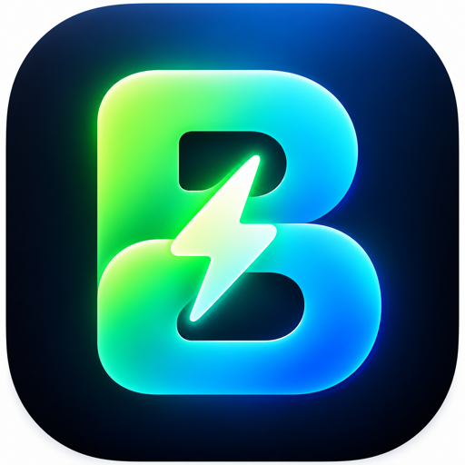

<p align="center">
  
</p>

<h1 align="center">BatMon</h1>

<p align="center">
  <strong>Smart battery monitor for Android devices with Home Assistant, MQTT, and Webhook automation.</strong>
</p>

<p align="center">
  <a href="LICENSE"></a>
  <a href="https://github.com/sunilsankar/BatMon/releases"></a>
  
</p>

---

## Purpose

Many Android devices—such as wall-mounted dashboard tablets, dedicated smart home controllers, security cameras, or repurposed phones—remain permanently connected to a charger. Continuous charging at 100% capacity accelerates battery degradation, creates chemical wear, and risks battery swelling (bloating).

**BatMon** prevents battery degradation by keeping your device charged within a healthy battery cycle (typically 45% to 80%):

1. **Automate Smart-Plug Charging:** Integrates with Home Assistant through MQTT or HTTP webhooks to automatically turn a smart plug on when the battery drops below your low threshold, and turn it off when the high threshold is reached.
2. **Local-First & Private:** Communicates directly with your local Home Assistant instance or MQTT broker. No external cloud services, third-party servers, or proprietary accounts required.
3. **Hardware Health Protection:** Protects retired and dedicated Android hardware from thermal stress and battery damage, safely extending their operational lifespan.
4. **Standalone & Connected Flexibility:** Works as an autonomous local battery monitor with threshold notifications, or as a connected sensor node in your home automation setup.

## Features

- **Modern Jetpack Compose UI:** Material 3 design with light/dark theme support, smooth typography, and responsive layouts tailored for phones and tablets in both portrait and landscape orientations.
- **Visual Battery Gauge:** Circular battery percentage dial displaying live charging state and configurable threshold markers.
- **Configurable Battery Thresholds:** Custom low (default 45%) and high (default 80%) threshold boundaries with validation rules.
- **MQTT & Home Assistant Discovery:** Standard MQTT 3.1.1 client support (Eclipse Paho v3), pre-flight TCP reachability verification, automatic Home Assistant MQTT sensor discovery (`battery_level`, `charging_status`, `temperature`, `health`, `last_update`, `is_charging`), Last Will and Testament (LWT) availability tracking, and individual metric telemetry topics.
- **HTTP Webhooks:** Event-driven webhooks for battery thresholds and charging states with a durable offline queue, exponential backoff retries, delivery history logs, and configurable JSON payloads.
- **Flexible Background Monitoring:**
  - **Low-Power Mode (Default):** Battery broadcast listener and WorkManager periodic background sync designed for minimal battery consumption.
  - **Real-Time Mode (Optional):** Foreground service with ongoing notification for near-instantaneous threshold alerts.
- **Stale Data Safety Protection:** Flags battery readings older than 30 minutes (3 minutes in real-time mode) as stale, preventing smart-plug automations from switching based on obsolete telemetry.
- **In-App Auto-Updates:** Built-in update checker and APK downloader powered by GitHub releases, allowing updates without Google Play Services.
- **Reboot Resilience:** Restores background monitoring and workers on device boot (`BOOT_COMPLETED`).
- **Security & Privacy First:** Zero personal data collection, credentials stored strictly in private app storage, HTTPS enforced by default, and sensitive tokens redacted from all logs.

## Build Requirements

- **JDK:** OpenJDK 17 or compatible.
- **Android SDK:** Compile SDK 35, Command-line tools, and platform `android-35`.
- **Gradle:** Uses included Gradle wrapper (`8.9`).

## Building & Testing

### Run Unit Tests
```bash
./gradlew test
```

### Build Debug APK
```bash
./gradlew assembleDebug
```
The resulting APK will be at `app/build/outputs/apk/debug/app-debug.apk`.

## MQTT & Home Assistant Integration

BatMon publishes battery metrics using MQTT 3.1.1 through Eclipse Paho v3 (compatible with standard Mosquitto, EMQX, and Home Assistant OS MQTT broker add-ons):

- **Architecture:** Based on the proven `dsmr2mqtt` pattern with pre-flight TCP reachability checking, conditional authentication, clean session, and an `offline` Last Will.
- **Availability / Status Topic:** `${mqttTopicPrefix}_${deviceShortId}/status` (`online` with retained LWT `offline`)
- **Telemetry Topics:** Publishes individual scalar readings to `${mqttTopicPrefix}_${deviceShortId}/<metricTag>` (`battery_level`, `temperature`, `charging_status`, `is_charging`, `health`, `last_update`)
- **State & Event Topics:** `${mqttTopicPrefix}_${deviceShortId}/state` and `${mqttTopicPrefix}_${deviceShortId}/event`
- **Home Assistant Auto-Discovery:** Publishes discovery definitions under `homeassistant/sensor/${mqttTopicPrefix}_${deviceShortId}/<metricTag>/config` using standard abbreviated HA discovery keys:
  - `sensor.<prefix>_<id>_battery_level`: Battery percentage (device class: `battery`)
  - `sensor.<prefix>_<id>_charging_status`: Charging status string (`charging`, `discharging`, `full`, `not_charging`)
  - `binary_sensor.<prefix>_<id>_is_charging`: Charging binary sensor (device class: `battery_charging`)
  - `sensor.<prefix>_<id>_temperature`: Battery temperature in °C
  - `sensor.<prefix>_<id>_health`: Battery health diagnostic sensor
  - `sensor.<prefix>_<id>_last_update`: ISO-8601 timestamp sensor
- **Security:** Credentials are protected in app private storage, never logged in plaintext, and trimmed automatically to prevent keyboard whitespace corruption.

## Webhooks

BatMon supports first-class HTTP webhooks independent of MQTT:

- **Supported Events:**
  - `battery_low`: Emitted when percentage falls to or below the low threshold.
  - `battery_high`: Emitted when percentage rises to or above the high threshold.
  - `charging_started`: Emitted when charger is connected.
  - `charging_stopped`: Emitted when charger is disconnected.
  - `state_update`: Emitted on periodic state sync.
  - `monitoring_warning`: Emitted when warnings or stale states are detected.
- **Durable Queue & Retries:** Failed webhook deliveries (due to offline state, network timeouts, or 5xx server errors) are placed in a durable queue backed by DataStore Preferences and retried with exponential backoff up to the configured retry limit. Permanent 4xx client errors are not retried indefinitely.
- **Security & Privacy:** HTTPS is enforced by default. Insecure HTTP requires explicit user opt-in with a visible security warning. All sensitive headers (`Authorization`, API keys) and tokens are redacted from logs and error messages. TLS certificate verification is never disabled.
- **Custom Payloads:** Supports JSON payload templating with dynamic variables (`{event}`, `{event_id}`, `{device_id}`, `{battery_percent}`, `{threshold_percent}`, `{is_charging}`, `{timestamp}`).

## Smart-Plug Charging Automation (Home Assistant)

Home Assistant is the designated authority for smart-plug switching. BatMon provides state telemetry via MQTT or Webhooks, and Home Assistant automations evaluate thresholds and command the charger switch.

### Key Policies & Safety Rules
1. **Default Thresholds:**
   - Turn charger **ON** when battery level drops to or below **45%** (if switch is currently OFF).
   - Turn charger **OFF** when battery level rises to or above **80%** (if switch is currently ON).
2. **Stale Data Protection:** Readings older than 30 minutes (or when availability is offline) are discarded to prevent unwanted charging switches based on outdated data.
3. **Duplicate Command Suppression:** Automations explicitly verify the current state of the switch prior to commanding it, eliminating redundant turn-on/turn-off calls.
4. **Manual Override Support:** Supports an `input_boolean` helper to temporarily suspend automated charging without disabling the automation.
5. **Reboot Recovery:** Automations trigger on `homeassistant.start` to safely re-evaluate fresh battery state after Home Assistant restarts.
6. **Switch Verification:** Verifies resulting switch state after switching and alerts if the smart plug failed to toggle.

### Example Automations
- **MQTT Automation:** See [`homeassistant/charging_automation.yaml`](homeassistant/charging_automation.yaml). Integrates with MQTT discovery sensors (`sensor.batmon_<device_id>_battery` and `binary_sensor.batmon_<device_id>_availability`).
- **Webhook Automation:** See [`homeassistant/webhook_charging_automation.yaml`](homeassistant/webhook_charging_automation.yaml). Integrates directly with BatMon webhook events (`battery_low` and `battery_high`).

## Platform & Background Execution Limitations

Android background execution is constrained by system policies and battery optimization:

1. **Low-Power Mode (Default):**
   - Uses `Intent.ACTION_BATTERY_CHANGED` while active in foreground or active process.
   - Leverages `WorkManager` periodic tasks for background sync.
   - **Constraint:** By Android design, WorkManager periodic work has a minimum 15-minute interval and is subject to Doze deferrals. Exact schedule execution cannot be guaranteed when the app is in the background.

2. **Real-Time Mode (Optional Foreground Service):**
   - Uses an Android Foreground Service with an ongoing notification (`android:foregroundServiceType="dataSync"`).
   - Keeps battery event listening active for instantaneous threshold crossing alerts.
   - **Trade-off:** Requires displaying a persistent notification and draws slightly more power.

3. **Stale Data Protection:**
   - Battery readings older than 30 minutes in low-power mode (or 3 minutes in real-time mode) are flagged as **stale**.
   - Per safety guidelines, stale readings are marked unsafe for smart-plug automated switching.

4. **Device & Manufacturer Restrictions:**
   - **Force-Stop:** If the user or OS force-stops BatMon, all background workers and broadcast receivers cease execution until the app is opened manually.
   - **OEM Battery Killers:** Devices from Samsung, Xiaomi, Huawei, etc., may kill background tasks unless BatMon is explicitly added to the device's battery optimization whitelist.
   - **Reboot Recovery:** A `BootCompletedReceiver` restores periodic WorkManager sync or restarts the real-time service after device reboot.

## Setup & Troubleshooting

For complete first-time configuration instructions, MQTT broker setup, Home Assistant discovery, and solutions for common issues, see [TROUBLESHOOTING.md](TROUBLESHOOTING.md).

## Author

**Sunil Sankar** ([@sunilsankar](https://github.com/sunilsankar))

## License

BatMon is open source software licensed under the [Apache License, Version 2.0](LICENSE).
